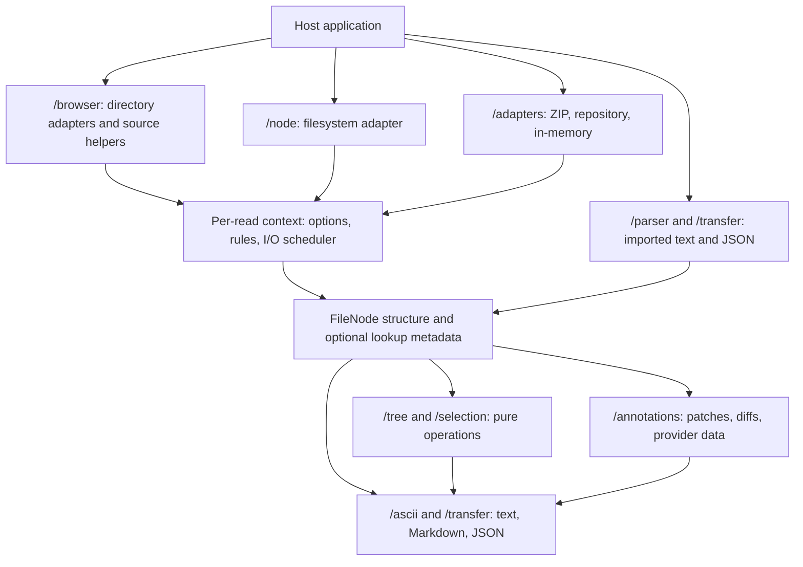

# Architecture

The 2.0 library follows a small pipeline: source adapters or parsers produce structural nodes, then pure operations edit, annotate, render, or export them. The package root is a convenience facade; environment-specific APIs remain in `/browser` and `/node`.

`FileSystemReader` optionally delegates to an active `ReaderAdapter`; direct `adapter.read()` calls use the same implementation. It does not own application state or introduce another option-merging layer.

- **Sources:** adapters retain handles, selected files, archive bytes, or source configuration. Native filesystem reads refresh the source; file lists and in-memory snapshots retain their selected data. See the [capability table](adapters.md#read-options).
- **Read state:** constructor defaults are copied, and each invocation gets independent effective options, ignore rules, and an I/O scheduler. Mutable traversal state never belongs to the shared tree or a previous read.
- **Structure:** `FileNode` contains names, paths, kinds, optional file metadata, and children. Importers register paths before storing annotations; edits share structural name validation. Neither layer stores source handles in the tree.
- **Indexes:** metadata is derived from nodes and attached non-enumerably under a versioned `Symbol.for` key shared across package entries. Cloning omits the index; preparation rebuilds it. Plain parser results can be queried without first attaching metadata.
- **Path maps:** internal dictionary helpers preserve arbitrary keys and ignore inherited properties. They do not introduce a new public collection type.
- **ZIP:** one helper reads and validates an individual central record; the archive indexer checks duplicates, ranges, and parent conflicts. Only reachable rule contents are decompressed. Immutable archives can reuse the index across reads.
- **Remote sources:** `http.ts` owns requests and pagination; `github.ts` and `gitlab.ts` own provider tree handling. The adapter maps their entries to the common tree.
- **Host responsibilities:** UI, application state, persistence, downloads, AI network calls, credentials, analytics, and notifications remain outside the library. Annotation providers are data contracts, not built-in model clients.

No plugin registry, background queue, or global source cache is required. Keep changes in the existing domain module and add a shared helper only when behavior truly needs one owner.
